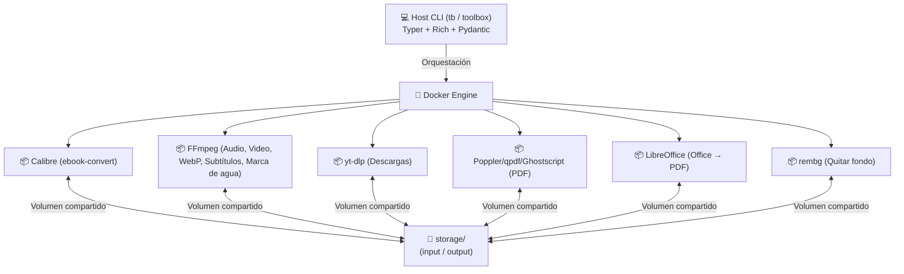

# 📦 Media Toolbox CLI

[](https://www.python.org/)
[](https://opensource.org/licenses/MIT)
[](https://github.com/astral-sh/ruff)
[](https://docs.docker.com/compose/)

Suite de herramientas de manipulación de medios y documentos aislada mediante micro-contenedores Docker. Procesa libros, videos, audios e imágenes sin saturar tu sistema operativo anfitrión con dependencias pesadas ni conflictos de librerías.

---

## 🏗️ Arquitectura



---

## 🚀 Prerrequisitos
- **Docker Desktop** (Engine & Docker Compose v2+)
- **Python 3.9+**

---

## ⚙️ Instalación Rápida

1. **Clonar el repositorio:**
   ```bash
   git clone https://github.com/atlas/media-toolbox.git
   cd media-toolbox
   ```
2. **Construir y descargar imágenes:**
   ```bash
   make build
   ```
3. **Instalar el comando CLI en modo editable:**
   ```bash
   make install
   ```
   *Esto habilitará el comando global `media` en tu terminal.*

---

## 🛠️ Herramientas Disponibles

### 📚 Libros y Documentos
- **Convertir a PDF:**
  ```bash
  media convertir [archivo] [--pagina a4|letter] [--perfil kindle|kobo|tablet] [--open]
  ```
  *Soporta `.epub`, `.mobi`, `.azw3`, `.fb2`, `.txt`, `.docx`.*

- **Unir PDFs:**
  ```bash
  media pdf unir [archivo1.pdf archivo2.pdf ...] [--salida final.pdf] [--open]
  ```

- **Rotar páginas de un PDF:**
  ```bash
  media pdf rotar [archivo.pdf] [--angulo 90|180|270] [--paginas 1-3] [--open]
  ```

- **Proteger un PDF con contraseña (AES-256):**
  ```bash
  media pdf proteger [archivo.pdf] [--password ****] [--open]
  ```

- **Convertir documentos de oficina (Word/Excel/PowerPoint) a PDF:**
  ```bash
  media pdf desde-office [archivo.docx|.xlsx|.pptx|.odt...] [--open]
  ```
  *Usa LibreOffice en modo headless, conservando el formato visual original.*

---

### 🎬 Video y Audio
- **Extraer Audio:**
  ```bash
  media audio [video] [--formato mp3|wav|m4a] [--open]
  ```
  *Soporta `.mp4`, `.mkv`, `.mov`, `.webm`, `.avi`, `.m4v`.*

- **Recorte Ultrarrápido (sin recodificar en 1 segundo):**
  ```bash
  media recortar [video] --desde 00:01:00 --hasta 00:02:30 [--open]
  ```

- **Generar GIF Animado:**
  ```bash
  media gif [video] --desde 00:00:10 --duracion 5s [--fps 15] [--ancho 480] [--open]
  ```

- **Comprimir Video (para Discord, WhatsApp o Web):**
  ```bash
  media comprimir [video] [--perfil equilibrada|ligera|maxima] [--open]
  ```

- **Extraer subtítulos embebidos:**
  ```bash
  media subtitulos extraer [video] [--pista 0] [--open]
  ```

- **Incrustar ('quemar') subtítulos en el video:**
  ```bash
  media subtitulos quemar [video] [subtitulo.srt] [--open]
  ```

---

### 🏷️ Marca de Agua
- **Superponer texto o logo en una imagen o video (detecta el tipo automáticamente):**
  ```bash
  media marca-agua [archivo] [--texto "© 2026"] [--logo logo.png] [--posicion bottomright] [--open]
  ```

---

### 🌐 Descargas Multimedia
- **Descargar desde URL (YouTube, Vimeo, etc.):**
  ```bash
  media descargar <URL> [--calidad 1080p|720p|max] [--playlist] [--open]
  ```
- **Descargar directamente sólo el Audio MP3:**
  ```bash
  media descargar <URL> --audio [--open]
  ```
  *Incrusta metadatos y carátulas automáticamente.*

---

### 🖼️ Imágenes
- **Convertir y Optimizar a WebP/JPG/PNG:**
  ```bash
  media imagen [archivo] [--formato webp] [--calidad 80] [--ancho 1200] [--open]
  ```

- **Quitar el fondo automáticamente:**
  ```bash
  media quitar-fondo [archivo] [--open]
  ```
  *Usa rembg (modelo U2Net) en un contenedor aislado; el resultado es un PNG con canal alfa transparente.*

---

### 📊 Sistema y Mantenimiento
- **Ver estado del almacenamiento y Docker:**
  ```bash
  media estado
  ```
- **Limpiar carpetas de entrada y salida:**
  ```bash
  make clean
  ```
- **Ejecutar tests automatizados:**
  ```bash
  make test
  ```
- **Validar formato y estilo:**
  ```bash
  make lint
  ```

---

## 💡 Opciones Globales
- `--verbose / -v`: Muestra registros detallados del contenedor en caso de error.
- `--open / -o`: Abre automáticamente la carpeta resultante en Finder al finalizar.
- **Rutas externas:** Puedes arrastrar archivos directamente al terminal (ej. `media audio ~/Downloads/clip.mp4`) y el toolbox los importará automáticamente.

---

## 🔒 Seguridad de la interfaz web

La interfaz web (`media web`) **no tiene autenticación** y su contenedor monta el
socket de Docker del host para poder orquestar las demás herramientas, lo cual
equivale a darle control total sobre el host. Por eso:

- El puerto se publica únicamente en `127.0.0.1` (loopback) por defecto en
  `docker-compose.yml`. No cambies esto a `0.0.0.0` ni lo expongas a tu LAN o a
  Internet sin colocarlo detrás de un reverse proxy con autenticación.
- Trata la interfaz web como una herramienta de confianza local, igual que el
  propio CLI: cualquiera que pueda alcanzar el puerto puede subir, leer,
  descargar y borrar archivos en `storage/`.
- ¿Quieres correr MediaBox en un servidor propio o en la nube y acceder desde
  fuera de `localhost`? Sigue la guía
  [Exponer la interfaz web de forma segura](docs/exponer-web-seguro.md)
  (reverse proxy con TLS + autenticación, o un túnel administrado como
  Cloudflare Tunnel / Tailscale).

---

## 🤝 Contribuciones y Comunidad

¡Las contribuciones son bienvenidas! Revisa los siguientes recursos para empezar:
- [Guía de Contribución](CONTRIBUTING.md)
- [Código de Conducta](CODE_OF_CONDUCT.md)
- [Historial de Cambios (Changelog)](CHANGELOG.md)

---

## 📄 Licencia

Este proyecto está bajo la Licencia **MIT** - consulta el archivo [LICENSE](LICENSE) para más detalles.